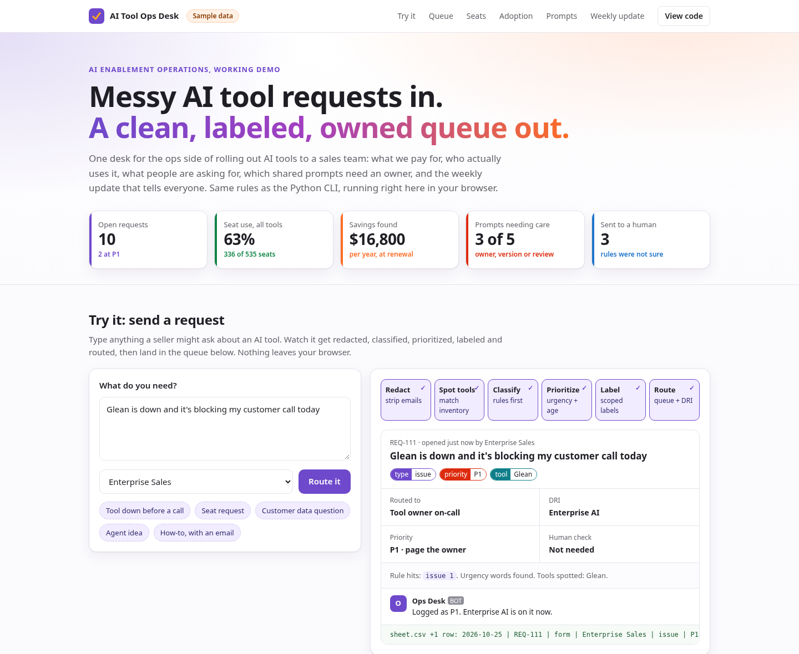
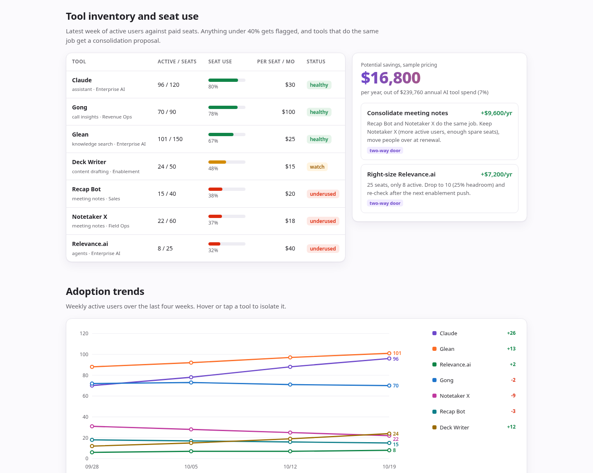
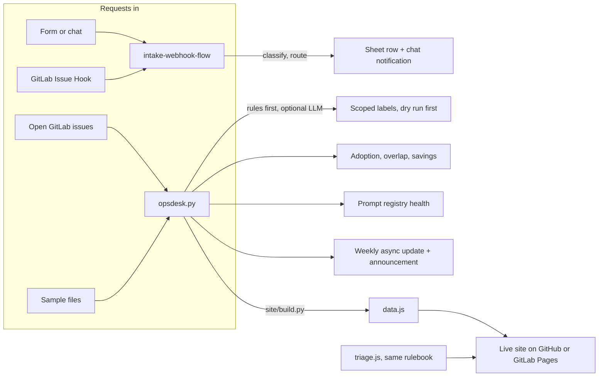

# AI ops demos

### [Live demo: AI Tool Ops Desk](https://sayyedsama.github.io/ai-ops-demos/) · runs in your browser, sample data, no sign-up

[](https://sayyedsama.github.io/ai-ops-demos/)

Two small, working samples of AI enablement operations, built from scratch with AI coding tools.
Standard-library Python and plain JavaScript, no API keys, tests on every push. All data is made up.

## Why this matters to an Enablement and AI team

- **Requests stop getting lost.** Seat asks, broken tools, ideas and "is this allowed?" questions are labeled, prioritized and routed to a named DRI in seconds, and anything unclear or sensitive goes to a person instead of being guessed.
- **Spend follows real use.** Seat use, adoption trends and overlapping tools turn into concrete proposals with a dollar figure ($16,800 a year in the sample), each one a two-way door.
- **Prompts are process.** Every shared prompt and agent is checked for an owner, a version and a recent review, and the weekly update plus a rollout announcement are written for you, ready to paste into an issue.

## What's inside

| | What it shows |
|---|---|
| [Live site](https://sayyedsama.github.io/ai-ops-demos/) ([`site/`](site/)) | The desk as one page: KPIs, a live "send a request" flow, the triage queue with scoped labels, inventory and seat use, savings, adoption chart, prompt library health and the auto-written weekly update. |
| [ai-tool-ops-desk](ai-tool-ops-desk/) | The engine. Triage requests from a file or a GitLab project with scoped labels (dry run first), track adoption vs seats, find overlap and savings, check the prompt registry, write a handbook-style async update. |
| [intake-webhook-flow](intake-webhook-flow/) | Form, JSON or GitLab Issue Hook webhook in, classify, route to an owner, append a spreadsheet row, send a chat notification. The n8n or Zapier pattern in one readable file. |

<p align="center"></p>

## How it fits together



The browser version uses the exact regex rulebook exported from the Python code, and a test runs `triage.js` in Node to prove both give the same labels, priority and route for the same request.

## 60-second walkthrough

0:00 to 0:08. Open the [live demo](https://sayyedsama.github.io/ai-ops-demos/). "This is the ops side of an AI rollout to a sales team, on sample data."
0:08 to 0:22. Click **Tool down before a call**. "Redacted, classified, P1 because a customer call is blocked, labeled, routed to the tool owner, and it lands at the top of the queue."
0:22 to 0:30. Click **Customer data question**. "Anything touching customer data goes to data governance and gets a human look."
0:30 to 0:40. Scroll to seats. "Two meeting-notes tools overlap and one agent platform sits at 32% of seats. That's $16,800 a year, proposed as two-way doors."
0:40 to 0:50. Scroll to prompts. "Prompts are process: one agent has no owner and is overdue for review."
0:50 to 1:00. Open the weekly update. "TL;DR, decisions with a DRI, and an announcement draft. The request I just sent is already in it."

The original terminal walkthrough is in [ai-tool-ops-desk/DEMO_SCRIPT.md](ai-tool-ops-desk/DEMO_SCRIPT.md).

## Run it yourself

```bash
cd ai-tool-ops-desk && python3 opsdesk.py --today 2026-10-25 && python3 -m unittest discover -s tests
cd ../intake-webhook-flow && python3 -m unittest discover -s tests
cd .. && python3 site/build.py && python3 -m http.server -d site 8000   # then open http://localhost:8000
```

Both engines run on rules alone and can optionally ask a local or hosted LLM to refine the result, falling back to rules if the model fails.

Also included: GitLab issue templates (`.gitlab/issue_templates/`), a `.gitlab-ci.yml` that runs the tests and publishes the site with GitLab Pages, and GitHub Actions for tests and Pages.

<sub>Independent portfolio demo. Not affiliated with or endorsed by GitLab or any tool vendor named here. Tool names are only there to make the scenario realistic. MIT licensed.</sub>
